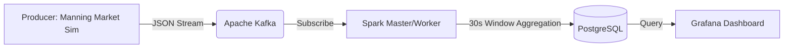

# 📊 Real-Time Analytics System for Sri Lankan Market Data

A high-performance, scalable streaming data pipeline designed to process and visualize Sri Lankan market prices in real-time using **Apache Kafka**, **Apache Spark**, and **Grafana**.


---

## 🏗️ System Architecture

The system follows a classic Lambda/Streaming architecture, entirely containerized:



1.  **Data Source**: Python producer simulating live price fluctuations at Colombo's Manning Market.
2.  **Ingestion Layer**: Confluent Kafka handles the high-throughput message stream.
3.  **Processing Layer**: Spark Structured Streaming (running in Docker) performs windowed aggregations.
4.  **Storage Layer**: PostgreSQL stores the processed analytics.
5.  **Visualization Layer**: Grafana provides real-time dashboards with pre-configured data sources.

---

## 🚀 Key Features

- **Fully Dockerized**: No need to install Spark or Kafka on your host machine.
- **Real-Time Streaming**: End-to-end latency of seconds.
- **Robust Processing**: Intelligent 30-second sliding windows.
- **Cross-Platform**: Optimized for both **Windows** and **Ubuntu**.
- **Auto-Provisioned**: Grafana comes pre-linked to the PostgreSQL database.

---

## 🛠️ Tech Stack

- **Broker**: Confluent Kafka & Zookeeper
- **Engine**: Apache Spark 3.5.0 (Master/Worker containers)
- **Database**: PostgreSQL
- **Viz**: Grafana
- **Language**: Python 3.x
- **Containerization**: Docker & Docker Compose

---

## 🚦 Getting Started

### 1. Initialize Infrastructure
Pull the images and start the containers:

**Windows:**
```powershell
./start.bat
```

**Ubuntu/Linux:**
```bash
chmod +x start.sh stop.sh submit_processor.sh
./start.sh
```

### 2. One-Time Setup
Initialize the database schema:
```bash
python3 setup_db.py
```

---

## 🔄 Daily Workflow

Once the setup is done, follow these steps to run the analytics:

1.  **Start Data Feed**:
    ```bash
    python3 producer.py
    ```
2.  **Submit Spark Job**:
    ```bash
    ./submit_processor.sh
    ```
3.  **View Dashboard**:
    Open `http://localhost:3000` (admin/admin).

---

## 📁 Project Structure

```text
.
├── grafana/                # Grafana provisioning configs
├── docker-compose.yml      # Infrastructure (Kafka, Spark, Postgres, Grafana)
├── producer.py             # Kafka data producer (Market Simulator)
├── processor.py            # PySpark streaming logic
├── submit_processor.sh     # Script to run Spark job in Docker
├── setup_db.py             # Database initialization (with retry logic)
├── requirements.txt        # Python dependencies
├── start.sh / .bat         # System startup scripts
└── stop.sh / .bat          # System shutdown scripts
```

---

## 👤 Author

**Sadeep Sachintha**
- GitHub: [@SadeepSachintha](https://github.com/SadeepSachintha)

---
*Developed as part of the Real-Time Analytics System project.*
